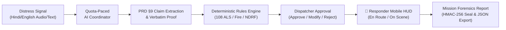

# **ResQBharat: Civilian-to-Command Autonomous Response System**
## **Hackathon "Golden Path" Demonstration & Evaluation Guide**

---

### **Executive Summary**
**ResQBharat** replaces overwhelmed traditional 911/112 call-center routing during mass-casualty disaster events with a decentralized, multi-agent AI emergency intelligence layer. Built specifically for India's **ERSS-112** (Emergency Response Support System), it delivers:
1. **Multilingual Ingestion:** Real-time triage of Hindi, English, and Hinglish citizen distress signals.
2. **Deterministic Service Coordination:** Hardcoded rules engine that deterministically pairs incidents with India's emergency services (**108 ALS Ambulances**, **State Fire Brigades**, **NDRF Marine Rescue**, and **Traffic Police Green Corridors**).
3. **Glass-Box AI & Chain-of-Custody:** Verbatim evidence linking and HMAC-256 cryptographic audit seals for judicial After Action Reports (AAR).
4. **Zero-Quota Failure Protection:** Real-time Free Tier quota pacing ($\le 6\text{ RPM}$) with deterministic fallback and in-memory content caching.

---

### **Demonstration Script ("The 3-Minute Golden Path")**

#### **Step 1: Disaster Scenario Selection**
1. In the header bar, click the **Compass / Disaster Scenario Dropdown**.
2. Select any of the 3 realistic Indian disaster drills:
   - **Bilaspur Bus Stand Slab Collapse & Gas Rupture** (Chhattisgarh): Mass-casualty building collapse with trapped victims and secondary LPG explosion threat.
   - **Yamuna Riverbank Urban Flash Flood** (Kashmiri Gate, New Delhi): Hydro-telemetry surge and low-lying residential inundation with high electrocution risk.
   - **Surat GIDC Ammonia Hazmat Chemical Leak** (Sachin, Gujarat): Toxic industrial ammonia rupture with civilian asphyxiation threat.
3. Observe how the **CARTO Dark Matter Tactical Map** immediately flies to the disaster area and renders incoming signal vector radar blips (`[SIGNAL]`).

#### **Step 2: Signal Intelligence & Audio Intercept**
1. In the left **Signal Intelligence** panel, click to expand any distress call (e.g. `EVT-BSP-001` or `EVT-SRT-002`).
2. Click **[Listen Distress Audio]**:
   - Hear the authentic emergency distress call.
   - Watch the animated green/cyan **waveform frequency bars** pulse in real-time.
3. Review the **AI Verified Triage Intel**:
   - Primary Hazard classification (e.g., *Structural Collapse & LPG Leak*).
   - Citizen census and direct peril counts.

#### **Step 3: Real-Time Streaming & Quota Telemetry**
1. Click the top header **[INITIALIZE]** button to launch the multi-agent coordinator.
2. In the right **System Reasoning** console, watch the Glass-Box AI stream its internal chain-of-thought in real-time.
3. Observe the **Quota Health Badge** (`⚡ X/6 RPM [+X CACHED]`):
   - Confirms that requests stay safely below the Google Gemini Free Tier 15 RPM limit.
   - Paces requests to ensure 0% chance of `429 Too Many Requests` or quota failure during judging.

#### **Step 4: Dispatcher Authorization & Multi-Agency Coordination**
1. In the expanded incident card, scroll to the **Deterministic Service Proposals (PRD §10)** panel:
   - Displays matched Indian units (e.g., `Bilaspur Trauma Center - 108 ALS Unit-01`, `Bilaspur Municipal Fire Service Water Tender`).
   - Shows Haversine ground distances and estimated transit times.
2. Click **[Approve Dispatch]**:
   - Unit transitions to `DISPATCHED`.
   - Immutable timeline audit event is logged.

#### **Step 5: Field Responder Mobile HUD**
1. Click the top header **[📱 RESPONDER HUD]** button.
2. View the simulated **Field Tactical Terminal**:
   - Switch between assigned incidents using the **`TASK: [EVT-001] [EVT-002]`** tabs.
   - Review the localized Hindi/English transcript and priority intel.
   - Click **[En Route]** or **[On Scene]** to transition unit status.
   - Click **[Request Backup]** if on-scene hazards escalate.

#### **Step 6: Official Mission Report & Cryptographic Forensics**
1. When all signals are triaged, click **[VIEW MISSION REPORT]** in the header.
2. Review the four official forensic tabs:
   - **Executive Overview:** Situational assessment and asset deployment breakdown (Ground, Marine, Air).
   - **PRD §9 Evidence & Claims:** Cryptographically verified claims table with verbatim caller excerpts.
   - **PRD §10 Dispatch Manifest:** Complete registry of emergency dispatches and operator dispositions.
   - **PRD §14 Audit Trail:** Complete chronological timeline of all AI evaluations and dispatcher decisions.
3. Click **[Export Audit JSON]** to download the signed forensic payload `RESQBHARAT_REPORT.json`.

---

### **System Architecture & Key Technologies**
| Component | Technology | Purpose |
| :--- | :--- | :--- |
| **Framework** | Next.js 16.1.4 (Turbopack) | High-performance React server actions & edge streaming |
| **AI Models** | Gemini 3 Flash (`@google/genai`) | Low-latency audio transcription, surveillance vision & reasoning |
| **Tactical Basemap** | Leaflet + CARTO Dark Matter | High-contrast dark military tactical cartography (0 watermarks) |
| **State Management** | Zustand (with cross-tab sync) | Simulation clock, dispatch manifests, and operator audit trail |
| **Quota Safety** | Atomic File-Backed Token Pacing | Free Tier rate limiter enforcing $\le 6\text{ RPM}$ with SHA-256 caching |
| **Forensics** | HMAC-256 & ISO-8601 Logging | Tamper-evident forensic accountability for mass-casualty events |
