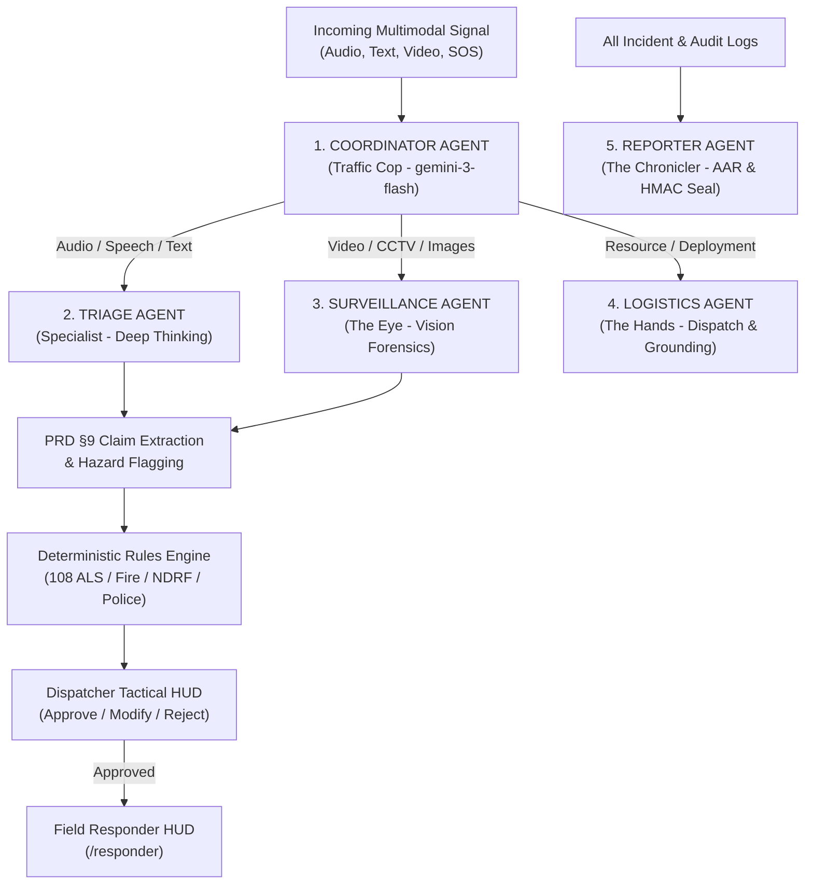

# 🇮🇳 ResQBharat: Comprehensive Repository & Architecture Overview

> **Version:** 2.0 (Hackathon Golden Path & Production Architecture)  
> **Repository:** `RazzGourav/AlienX-GGH` / `ResQBharat`  
> **Core Thesis:** "Civilian-to-Command" Multi-Agent Autonomous Emergency Intelligence & Response System for India (ERSS-112).  
> **Target Audience:** Autonomous AI Coding Agents, Pair Programmers, and Core Maintainers.

---

## 1. Executive Summary & Mission Statement

**ResQBharat** is an AI-assisted emergency intelligence and coordination layer engineered for mass-casualty disasters (urban flash floods, structural building collapses, industrial hazmat leaks, fires) and everyday high-stress dispatch in India.

When disasters strike, legacy emergency telephony (such as ERSS-112 or traditional 911 call centers) inevitably bottlenecks under hundreds of concurrent calls. ResQBharat replaces brittle call queues with an autonomous, hierarchical multi-agent intelligence layer that:
1. **Ingests Multimodal & Multilingual Signals:** Processes voice recordings, SOS beacons, Hindi/English/Hinglish distress messages, CCTV, and drone video footage.
2. **Operates as "Glass-Box AI":** Replaces black-box opaque outputs with real-time streaming `reasoning_trace` deduction logs and cryptographic `thought_signature` tokens (HMAC-SHA256) for a tamper-evident audit trail.
3. **Guarantees 100% Demo Uptime via "Simulation-First" & Quota Protection:** Uses a deterministic simulation playback clock, seeded scenarios across Indian cities (Bilaspur, Delhi, Surat), and an internal Quota Manager pacing requests ($\le 6\text{ RPM}$) with instant fallback to a tokenless heuristic triage engine.
4. **Enforces Human-in-the-Loop ("Protocol Zero"):** Suggests deterministic Indian emergency services (**108 ALS Ambulances**, **State Fire Brigades**, **NDRF Marine Rescue**, **Traffic Police Green Corridors**) that human dispatchers can approve, modify, or reject.
5. **Closes the Loop (Civilian ⇄ Command ⇄ Field Responder):** Provides dedicated portals for Citizens (Web & Mobile Expo app), Command Operators (Tactical Dark HUD), and Field Responders (Mobile HUD).

---

## 2. Workspace Map & Directory Structure

```
.
├── .agent/                    # Workspace agent tools & workflow skills
│   └── skills/
│       ├── demo-playback/     # Instructions for automated demo walkthrough
│       ├── generate-scenario/ # Skill for creating synthetic Doomsday scenarios
│       ├── impeccable/        # Frontend polish and design system refinement
│       └── scaffold-agent/    # Boilerplate generator for new specialized agents
├── .agents/                   # Custom agent configurations
│   └── skills/
│       ├── design-taste-frontend/ # Anti-slop UI guidelines & design aesthetics
│       └── impeccable/        # Design system & visual polish guidelines
├── .gemini/                   # Gemini Antigravity IDE configuration
├── citizen-app/               # Standalone Expo / React Native mobile app for citizens
│   ├── App.tsx                # Native SOS trigger, audio recorder, camera, GPS
│   ├── app.json               # Expo configuration & permissions
│   └── package.json           # React Native 0.86, Expo 57 dependencies
├── public/                    # Static demo assets (audio clips, sample drone footage)
├── src/
│   ├── agents/                # Hierarchical Multi-Agent logic
│   │   ├── coordinator.ts     # The Traffic Cop: routes inputs to specialized agents
│   │   ├── triage.ts          # The Specialist: analyzes distress calls & extracts claims
│   │   ├── surveillance.ts    # The Eye: video/image vision analysis & flood metrics
│   │   ├── logistics.ts       # The Hands: resource matching & Haversine routing
│   │   └── reporter.ts        # The Chronicler: generates After Action Reports (AAR)
│   ├── app/                   # Next.js 16 App Router
│   │   ├── api/
│   │   │   ├── coordinate/stream/ # SSE streaming endpoint for AI thoughts & triage
│   │   │   ├── quota/         # Live API quota health & RPM telemetry
│   │   │   └── signals/live/  # Ingestion & polling endpoint for live citizen SOS
│   │   ├── citizen/           # Multilingual citizen emergency PWA web page
│   │   ├── responder/         # Mobile-first field responder HUD
│   │   ├── globals.css        # Tactical dark mode styles & CRT scanline effects
│   │   ├── layout.tsx         # Root layout with fonts and metadata
│   │   └── page.tsx           # Main Command Center Dashboard
│   ├── components/            # UI Components
│   │   ├── CommanderControls.tsx   # Manual voice-of-god command overrides
│   │   ├── LeafletTacticalMap.tsx  # Fallback offline Leaflet map implementation
│   │   ├── MissionReportModal.tsx  # Executive AAR modal with HMAC signature & export
│   │   ├── QuotaHealthBadge.tsx    # Live RPM and cache telemetry badge
│   │   ├── ReasoningLog.tsx        # Glass-box live streaming typewriter console
│   │   ├── ResponderMobileView.tsx # Responder simulation modal in dashboard
│   │   ├── ScenarioSelector.tsx    # Dropdown for switching Indian disaster scenarios
│   │   ├── ServiceProposalPanel.tsx # PRD §10 service proposals & unit matching
│   │   ├── SignalFeed.tsx          # Real-time incident list with audio player
│   │   └── TacticalMap.tsx         # CARTO Dark Matter interactive Leaflet/Google map
│   ├── data/                  # Static disaster datasets & resources
│   │   ├── mock_stations.json # Seeded Indian hospitals, fire stations, NDRF bases
│   │   └── scenarios.json     # 3 Indian disaster drills (Bilaspur, Delhi, Surat)
│   ├── hooks/                 # React Hooks
│   │   ├── useDisasterSimulation.ts # High-precision simulation playback engine
│   │   └── useLiveCitizenFeed.ts    # Background poller for live incoming SOS reports
│   ├── lib/                   # Core engines and utilities
│   │   ├── constants.ts       # Model name configurations (`gemini-3-flash-preview`)
│   │   ├── dedup-engine.ts    # Geospatial & textual incident deduplication
│   │   ├── deterministic-triage.ts # Heuristic zero-token instant triage fallback
│   │   ├── gemini-client.ts   # Google GenAI client instance & HMAC generator
│   │   ├── gemini-utils.ts    # Auto-retry with backoff, failover & JSON repair
│   │   ├── geo-utils.ts       # Haversine distance & nearest station calculator
│   │   ├── quota-manager.ts   # File-synced rate limiter & cache manager (<=6 RPM)
│   │   ├── rules-engine.ts    # Deterministic emergency service pairing rules
│   │   ├── store.ts           # Central Zustand store (persisted state & actions)
│   │   ├── types.ts           # Strict TypeScript contracts (PRD §9 & §10 compliant)
│   │   ├── utils.ts           # Tailwind `cn()` helper
│   │   └── video-utils.ts     # Video frame extraction helpers (ffmpeg)
│   ├── seed/
│   │   └── seed_data.json     # Canonical fallback simulation events
│   └── simulation/
│       └── simulation_data.json # Active playback timeline script
├── CONTEXT.md                 # Original architecture specification document
├── DEMO_GUIDE.md              # 3-minute hackathon judge walkthrough script
├── GEMINI.md                  # Project mission constraints & agent rules
├── package.json               # Next.js 16, React 19, Tailwind 4, Google GenAI
├── README.md                  # Public repo overview & quickstart
└── ResQ_Bharat_PRD.md         # Comprehensive 41KB Product Requirement Document
```

---

## 3. Technology Stack & Key Dependencies

| Layer | Technology | Details & Purpose |
| :--- | :--- | :--- |
| **Frontend Framework** | Next.js 16.1.4 (App Router) | React 19.2.3, server actions (`"use server"`), Node.js runtime for API streaming. |
| **Mobile Native App** | Expo 57 / React Native 0.86 | Standalone native app (`citizen-app`) with `expo-location`, `expo-audio`, `expo-image-picker`. |
| **Styling & Theme** | Tailwind CSS v4, Lucide React, Framer Motion | "AI Centric Agentic Tactical Dark Mode" (glassmorphism, monospace fonts, scanlines). |
| **Cognitive Engine** | `@google/genai` (v1.38.0) | Targets `gemini-3-flash-preview` / `gemini-3-pro-preview` with Deep Thinking enabled. |
| **Geospatial Visualization**| React Leaflet 1.9.4 & `@vis.gl/react-google-maps` | CARTO Dark Matter tiles, custom SVG animated radar blips, unit markers, boundary rings. |
| **State Management** | Zustand 5.0.10 | Single source of truth, persistent storage, cross-tab synchronization. |
| **Video Forensics** | `ffmpeg-static` & `fluent-ffmpeg` | Local frame sampling (1 frame per 2s) for drone & CCTV forensics. |

---

## 4. Multi-Agent System Architecture

ResQBharat implements a **Hierarchical Multi-Agent Orchestration Pattern**:



### Agent Roles & Specifications

1. **Coordinator Agent (`src/agents/coordinator.ts`):**
   - **Role:** Fast dispatcher. Inspects incoming signal mime types and semantic context.
   - **Routing Rules:** Audio/SMS/Hinglish text $\to$ **Triage**; Drone/CCTV $\to$ **Surveillance**; Asset dispatch $\to$ **Logistics**.
   - **Model:** `gemini-3-flash-preview` (low latency).
   - **Fallback:** Deterministic regex and file-extension inspection when quota is constrained.

2. **Triage Agent (`src/agents/triage.ts`):**
   - **Role:** Analyzes dialect nuance (Hindi, Hinglish, regional phrasing), extracts atomic claims (`PRD §9`), detects trapped civilians, and identifies secondary hazards (submerged electrical wiring, LPG leaks).
   - **Thought Signature:** Emits an HMAC-SHA256 signature (`generateThoughtSignature`) to certify chain-of-custody.
   - **Model:** `gemini-3-flash-preview` with `thinkingConfig: { thinkingLevel: "HIGH" }`.

3. **Surveillance Agent (`src/agents/surveillance.ts`):**
   - **Role:** Analyzes drone video frames and image evidence.
   - **Forensics:** Evaluates flood depth (centimeters/meters), structural damage grades (Minor, Moderate, Critical Collapse), and human entrapment.
   - **Optimization:** Extracts 1 frame every 2 seconds to preserve token efficiency.

4. **Logistics Agent (`src/agents/logistics.ts`):**
   - **Role:** Calculates Haversine distances to the nearest Indian stations (`src/data/mock_stations.json`).
   - **Pairing:** Matches incidents to specific real-world Indian response units (e.g., *108 ALS Ambulance*, *NDRF 10-man Inflatable Boat*, *Water Tender 5000L*).
   - **Grounding:** In live AI mode, uses Google Search grounding queries to verify potential road blocks.

5. **Reporter Agent (`src/agents/reporter.ts`):**
   - **Role:** Compiles official After Action Reports (AAR) upon mission completion or operator demand.
   - **Output:** Structured JSON containing executive summary, operational metrics (air/marine/ground counts, Protocol Zero interventions), full timeline audits, and HMAC-signed digital seals.

---

## 5. Dual-Mode Operation & Safeguards

### 5.1 Mode 1: Deterministic Simulation Engine
- Managed by `useDisasterSimulation.ts` and `src/data/scenarios.json`.
- Plays back timed disaster scenarios without relying on live external networks.
- Three pre-configured Indian scenarios:
  1. **Bilaspur Bus Stand Slab Collapse & Gas Rupture** (Chhattisgarh): 4 trapped civilians, LPG explosion risk, traffic blockage on Raipur Road.
  2. **Yamuna Riverbank Urban Flash Flood** (Kashmiri Gate, New Delhi): Rising floodwaters, electrocution risks, boat evacuation.
  3. **Surat GIDC Ammonia Hazmat Chemical Leak** (Sachin, Gujarat): Ammonia cloud, asphyxiation threat, mandatory evacuation perimeter.

### 5.2 Mode 2: Live Citizen SOS Ingestion
- Enabled via `isLiveCitizenMode` in `store.ts` and polled through `useLiveCitizenFeed.ts`.
- Citizens submit real-time distress reports via `/citizen` or the `citizen-app/` Expo native app.
- Reports arrive at `/api/signals/live` with base64 audio/photo, GPS latitude/longitude, category hint, and Google authentication profile.
- Real-time signals are prioritized and injected seamlessly into the Command Center radar.

### 5.3 Zero-Quota Failure Safeguard (`src/lib/quota-manager.ts`)
To prevent `429 Too Many Requests` during high-stakes demonstrations on Google Gemini's Free Tier:
- **Hard Rate Limit:** Paced at $\le 6\text{ RPM}$ (well below the 15 RPM limit).
- **Turbopack Multi-Thread Sync:** State synchronized via `.next/resq_quota_state.json`.
- **Response Caching:** Identical distress inputs are served instantly from cache.
- **Deterministic Triage Fallback (`src/lib/deterministic-triage.ts`):** When the rate limit is reached or the network fails, incidents instantly fall back to local rule-based heuristic triage with 0ms latency and 0 tokens consumed.

---

## 6. PRD Specifications Alignment

ResQBharat directly implements the core technical specifications of `ResQ_Bharat_PRD.md`:

| PRD Section | Architectural Feature | Implementation File |
| :--- | :--- | :--- |
| **PRD §8** | Deterministic Mock Emergency Station Network | `src/data/mock_stations.json`, `src/lib/geo-utils.ts` |
| **PRD §9** | Separation of Raw Evidence (`ReportSource`) and Atomic Claims (`ExtractedClaim`) | `src/lib/types.ts`, `src/agents/triage.ts`, `src/lib/deterministic-triage.ts` |
| **PRD §9** | Contradiction & Ambiguity Surfacing (`ConflictRecord`) | `src/lib/types.ts`, `src/components/ServiceProposalPanel.tsx` |
| **PRD §10**| Deterministic Emergency Service Proposal Matrix | `src/lib/rules-engine.ts`, `src/lib/deterministic-triage.ts` |
| **PRD §11**| Deduplication & Bystander Report Merging | `src/lib/dedup-engine.ts`, `src/lib/store.ts` |
| **PRD §12**| Human Dispatcher Authorization Actions (Approve / Modify / Reject) | `src/lib/store.ts`, `src/components/ServiceProposalPanel.tsx` |
| **PRD §13**| Field Responder Mobile HUD with Live Status Transitions | `src/app/responder/page.tsx`, `src/components/ResponderMobileView.tsx` |
| **PRD §14**| Immutable Audit Log & HMAC-Signed Mission Handover Report | `src/agents/reporter.ts`, `src/components/MissionReportModal.tsx` |

---

## 7. Frontend User Interfaces

The repository provides three distinct, purpose-built interfaces:

### 1. Tactical Command Center (`/` $\to$ `src/app/page.tsx`)
- **CARTO Dark Matter Tactical Map (`TacticalMap.tsx`):** Displays real-time incident pins, radar blips, active scenario boundaries, and assigned unit routes.
- **Signal Feed (`SignalFeed.tsx`):** Expandable cards displaying audio waveforms, Hindi/English translations, claim-level evidence badges, and service proposals.
- **Reasoning Log (`ReasoningLog.tsx`):** Terminal-style typewriter HUD visualizing the AI's internal monologue, thought tokens, and agent handoffs.
- **Commander Controls (`CommanderControls.tsx`):** Voice-of-god command overrides allowing operators to inject global broadcast commands.
- **Quota Telemetry Badge (`QuotaHealthBadge.tsx`):** Real-time indicator displaying active RPM, cache hit ratios, and quota health status.

### 2. Responder Field HUD (`/responder` $\to$ `src/app/responder/page.tsx`)
- Tailored for emergency personnel on mobile devices.
- Filter by asset role: **AIR** (Helicopter/Drone), **MARINE** (Rescue Boat), **GROUND** (Ambulance/Fire Tender).
- Real-time status progression buttons: `PENDING` $\to$ `ACKNOWLEDGED` $\to$ `EN_ROUTE` $\to$ `ON_SCENE` $\to$ `RESOLVED`.
- One-tap "REQUEST BACKUP" trigger that alerts the Command Center.

### 3. Citizen Distress Portal (`/citizen` $\to$ `src/app/citizen/page.tsx` & `citizen-app/`)
- Accessible in English and Hindi (मदद एवं आपातकालीन रिपोर्टिंग).
- High-contrast 1-Click SOS button triggering simultaneous GPS broadcast.
- Voice note audio recorder, camera photo upload, and structured category selector (Crime, Medical, Fire, Flood, Women Safety).
- Google OAuth login integration for verified citizen identity.

---

## 8. Core Data Contracts (`src/lib/types.ts`)

Any agent making modifications must adhere strictly to these core interfaces:

```typescript
// Core Incident Model
export interface Incident {
    id: string;
    type?: "AUDIO" | "VIDEO" | "TEXT" | "COMMAND" | "IMAGE";
    raw_input: string;
    timestamp: string;
    location: {
        lat: number;
        lng: number;
        address?: string;
    };
    status: "PENDING" | "ANALYZING" | "TRIAGED" | "RESOLVED";
    priority?: "CRITICAL" | "HIGH" | "MEDIUM" | "LOW";
    category?: string;
    reasoning_trace?: string;
    thought_signature?: string;
    required_asset?: "AIR" | "MARINE" | "GROUND" | "General";
    
    // PRD §9 Evidence & Claims
    source_records?: ReportSource[];
    extracted_claims?: ExtractedClaim[];
    conflicts_list?: ConflictRecord[];
    service_proposals?: ServiceProposal[];
    timeline_events?: AuditTimelineEvent[];
    
    // Responder & Citizen State
    responder_status?: "PENDING" | "ACKNOWLEDGED" | "EN_ROUTE" | "ON_SCENE" | "RESOLVED";
    citizen_reporter?: CitizenProfile;
    is_live_citizen?: boolean;
    is_simulated?: boolean;
}

// PRD §9 Atomic Claim
export interface ExtractedClaim {
    claim_id: string;
    source_id: string;
    fact_type: "hazard" | "injury" | "location" | "structural" | "time" | "general";
    claim_text: string;
    excerpt?: string;
    evidence_strength: "strong" | "partial" | "needs_review";
    validation_state: "unverified" | "corroborated" | "conflicted";
}

// PRD §10 Deterministic Service Proposal
export interface ServiceProposal {
    service_category: "medical" | "police_traffic" | "police_crime" | "fire_rescue" | "disaster_response";
    rule_id: string;
    rationale: string;
    recommended_units: string[];
    operator_status: "proposed" | "approved" | "modified" | "rejected";
    matched_mock_unit_id?: string;
    estimated_distance_km?: number;
}
```

---

## 9. Developer & AI Agent Guidelines

When modifying this repository, all AI agents and developers **MUST** observe the following invariant rules:

1. **Preserve Deterministic Fallbacks:**
   - Under no circumstances should the system crash if `GEMINI_API_KEY` is invalid, empty, or hitting quota exhaustion.
   - `src/lib/deterministic-triage.ts` and `src/lib/rules-engine.ts` must always remain functional and testable without external network dependencies.

2. **Respect the Quota Pacing Threshold:**
   - All server-side Gemini API calls must pass through `canMakeAPIRequest()` from `src/lib/quota-manager.ts`.
   - Never remove or bypass the `SAFE_MAX_RPM` limiter.

3. **Glass-Box Transparency:**
   - Any new agent logic added must produce a `reasoning_trace` and an HMAC `thought_signature`. Never output plain labels without explaining the causal deduction chain.

4. **Strict Schema Integrity:**
   - When modifying incident state, ensure all modifications conform to `Incident` in `src/lib/types.ts`.
   - Always append an `AuditTimelineEvent` when modifying status or dispatch assignments.

5. **Local Development Commands:**
   ```bash
   # Run development server
   npm run dev

   # Verify TypeScript and linting
   npm run lint

   # Test Citizen Expo mobile app
   cd citizen-app && npm start
   ```

---

**ResQBharat — Civilian-to-Command Autonomous Emergency Intelligence** 🇮🇳
